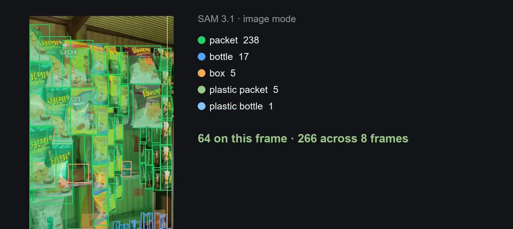
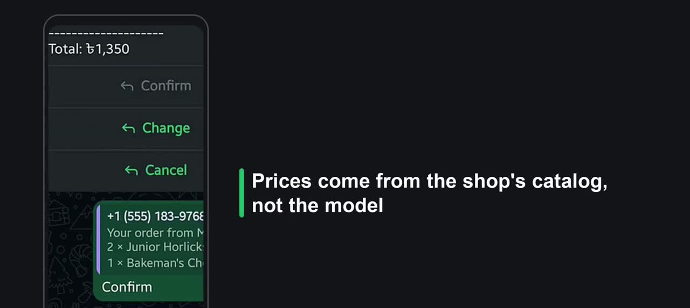
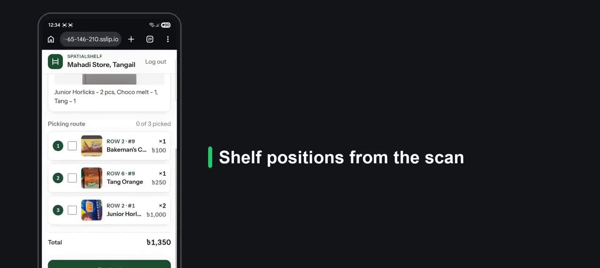
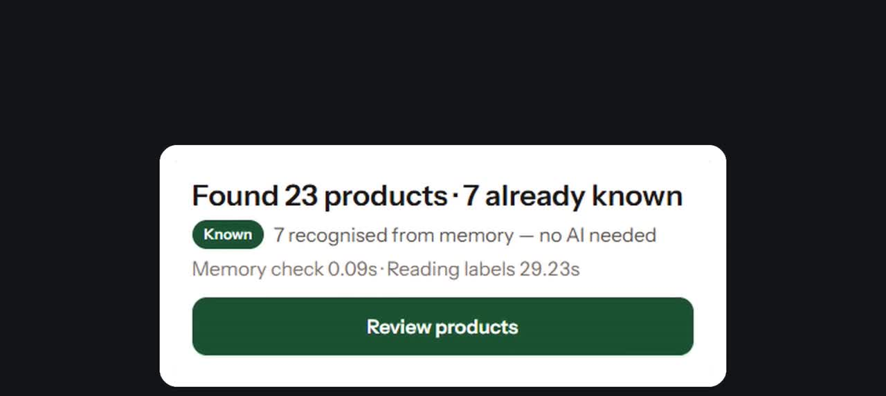
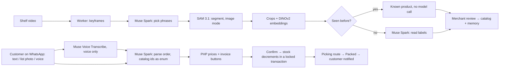

# SpatialShelf

**Film a shelf. Get a WhatsApp shop.**

A shopkeeper films a shop shelf for about 10 seconds on a phone. SpatialShelf turns that video into a catalog that customers can order from on WhatsApp: by typed text, a photo of a handwritten list, or a voice note in Bangla or English. Stock goes down on confirm, the shopkeeper gets a picking route with shelf positions, and the next scan recognises products it has already seen.

Built during the **Meta Global AI Developer Hackathon (Oct 26 – Nov 4, 2026)** · Indie track · theme *Build for Your World*.

## For judges: start here

| | |
|---|---|
| **Watch** | [3-minute demo video](https://youtu.be/jGyzvsa5X6M) (2:19, English voiceover and captions) |
| **Try it, no login** | [159-65-146-210.sslip.io/try](https://159-65-146-210.sslip.io/try): send a text, a list photo or a voice note and get the same invoice the WhatsApp bot sends |
| **Live shop app** | [159-65-146-210.sslip.io](https://159-65-146-210.sslip.io) (merchant login) |
| **Read** | [How it works](#how-it-works) · [Measured results](#measured-not-claimed) · [Spike log](spikes/RESULTS.md) |

> The WhatsApp test number can only message 5 verified phones, so `/try` runs the exact same order pipeline for anyone.

| SAM 3.1 finds every product | Invoice on WhatsApp | Picking route from the scan | Visual memory on rescan |
|---|---|---|---|
|  |  |  |  |

## Why

Small neighbourhood shops in Bangladesh carry hundreds of products and have no catalog. Their customers already order on WhatsApp: a typed message, a voice note, a photo of a list written on paper. The shopkeeper reads every message, prices it from memory and searches the shelf. SpatialShelf keeps that habit and does the slow parts: building the catalog from a video, reading the order, pricing it, tracking stock and telling the shopkeeper where each item sits.

## What the demo shows

All footage is from our own phone. The shelves were filmed in a real shop in Tangail, Bangladesh; the demo shop in the app is set up as "Mahadi Store, Tangail". Prices are in Taka (৳).

1. **Scan.** One shelf video → 8 keyframes → Muse Spark picks what to search for (`plastic packet`, `plastic bottle`, plus a safety net of `jar`, `box`, `packet`, `bottle`) → SAM 3.1 returns **266 detections**, grouped into **45 candidate products** (Scan 5).
2. **Review.** The shopkeeper confirms or fixes each product and sets the price. Confirmed products go into stock and into visual memory.
3. **Order by list photo.** A customer sends a photo of a handwritten list. The bot replies with an invoice (2× Junior Horlicks Stage 2, 1× Bakeman's Choco Melt, 1× Tang Orange, total ৳1,350) with Confirm / Change / Cancel buttons.
4. **Order by voice note.** "দুইটা Fresh Energy Biscuit লাগবে" (Bangla and English mixed) → transcript → 2× Fresh Energy Biscuit, ৳120.
5. **Pick and pack.** The merchant screen shows the original list and a picking route with shelf positions from the scan. **Packed** sends the customer a WhatsApp message.
6. **Rescan.** A second video of a shelf we had already confirmed: **23 products found, 7 recognised from memory** with no model call.

## Measured, not claimed

Day-1 probes with small samples, not hand-labelled ground truth. Full notes: [eval/ACCURACY.md](eval/ACCURACY.md), raw runs in [spikes/RESULTS.md](spikes/RESULTS.md).

| What we tested | Result | Why it matters |
|---|---|---|
| SAM 3.1 image mode vs video mode | **83** objects in the best frame vs video mode's cap of **16** tracked objects | Image mode detects; video mode only draws the overlay |
| Muse Spark picking SAM phrases vs a generic prompt | **40** confident boxes (≥0.7) vs **4** for `product package` | The phrase picker adapts to each shelf |
| Order parsing (4 test orders, 15-product catalog) | **7** matched, **7** sent back as questions, **0** silently wrong | The model can only choose real product ids; unclear lines become a question |
| Crop reading, 4K vs 720p crops | Mean confidence **0.71** vs **0.59** | Crops are cut from full-resolution frames |
| Visual memory on a real rescan (Scan 6) | **7 of 23** products recognised from memory, distances 0.068–0.154 | Known products skip the label-reading model call |

The 83-vs-16 probe used a short royalty-free stock test clip on day 1; every other number above, and everything in the demo video, comes from our own footage.

## How it works

Two services, one database. Laravel owns everything users touch; a small Python worker does the pixel work. **Models never do arithmetic or write to the database**: they return JSON via `response_format: json_schema`, and PHP validates, prices and saves.



### Scan pipeline

1. Laravel stores the upload and dispatches `ProcessScan` on the `scans` queue.
2. The worker downsamples with ffmpeg (720p, 4 fps) and picks 6–8 sharp keyframes.
3. **Muse Spark picks what SAM looks for**: one keyframe in, packaging noun phrases out. These become SAM 3.1 prompts, one phrase per request, plus a fixed safety net (`jar`, `box`, `packet`, `bottle`).
4. SAM 3.1 runs in **image mode** per phrase. Boxes overlapping more than 60% IoU, or one box at least 70% inside another, are merged.
5. Best frame per object → crop from the full-resolution frame → DINOv2 embedding (384-d).
6. PHP groups crops with cosine similarity ≥ 0.84 (tuned on our shelves) into one candidate SKU; group size = facing count.
7. Each group's best crop is matched against confirmed `product_images`. Within distance 0.16 → "Known": reuse the product, no model call.
8. Unknown groups go to Muse Spark in batches of 8 with a JSON schema (name, brand, size, category). Estimated stock = facings × a category depth default, always shown with `~`.
9. The review screen shows cards with confidence badges; the merchant confirms into `products` and memory.

### Order pipeline

1. The webhook verifies `X-Hub-Signature-256`, returns 200 fast and queues on `whatsapp`.
2. Voice notes are converted (`ffmpeg -i note.ogg -ac 1 -ar 24000 -c:a pcm_s16le note.wav`) and sent to `muse-voice-transcribe-1.0` with `languageBias: [Bengali, English]` and `keywords` = the top 50 in-stock product and brand names.
3. **Muse Spark parses the order** with the live catalog in the schema as an `enum` of product ids, so it can only pick a real id or `"none"`. Ambiguous lines (`tel` → two oils) return `alternative_ids`, and the bot asks one list question before the invoice.
4. PHP prices every line from `products`, totals, and saves `orders` + `order_lines` as a draft. Confirm decrements stock inside one transaction with `lockForUpdate`.
5. The merchant sees the order with the original input and a picking route in shelf order; **Packed** notifies the customer. Confirmed customer phrasings are added to `products.aliases`, the text-side learning loop.

### Which Meta model does what

| Step | Model | Input | Output |
|---|---|---|---|
| Pick SAM phrases | `muse-spark-1.3` | 1 keyframe | packaging noun phrases for this shelf |
| Find products | `sam-3.1` | keyframes + phrases | boxes + masks |
| Read each product | `muse-spark-1.3` | batch of 8 crops | name, brand, size, category |
| Parse list / text / transcript | `muse-spark-1.3` | message or image + catalog enum | order lines matched to product ids |
| Transcribe voice | `muse-voice-transcribe-1.0` | 24 kHz mono WAV | transcript |
| Visual memory | DINOv2 `facebook/dinov2-small`, Meta open weights, on the worker's CPU | crop | 384-d vector stored in MySQL JSON |

Cost check: about $0.04 of SAM per scan; Spark $1.25 / $4.25 per million tokens; voice $0.18 per hour.

### Key engineering decisions

- Prompts and JSON schemas live in `prompts/` as files, loaded at runtime, never inlined.
- All Meta calls go through `app/app/Services/Meta/*` (PHP) or `worker/services/*` (Python). No model calls in controllers.
- Every raw model response is stored (`scans.stats`, order `context`) for debugging and for the demo.
- Embeddings are JSON arrays; similarity is brute-force cosine in PHP, fast enough for a few thousand images, with no vector database to run.
- Stock only changes inside a locked transaction; `stock_is_estimate` stays true until the merchant edits the count (the UI shows `~`).

## Repo layout

```text
spatialshelf/
  app/                  Laravel 13 (web app, API, webhook, jobs)
    app/Services/Meta/  MuseSpark, VoiceTranscribe, MetaClient
    app/Services/WhatsApp/  WhatsAppClient, InvoiceFormatter
    app/Services/Catalog/   SkuGrouper, MemoryMatcher, VectorIndex
    app/Services/Orders/    OrderIntake, DraftOrderBuilder, OrderService
    app/Jobs/           ProcessScan, HandleInboundMessage
  worker/               Python FastAPI (ffmpeg, SAM 3.1, crops, DINOv2)
  prompts/              system prompts + JSON schemas, versioned
  spikes/               day-1 probes + RESULTS.md (kept, not used at runtime)
  eval/                 accuracy notes (ACCURACY.md)
  samples/              list photos, voice notes (videos are not committed)
  storage-shared/       videos, crops, audio, read and written by both services
  deploy/               server-setup.sh, deploy.sh, nginx + supervisor configs
  docs/                 spec.md (build spec), deploy.md (live runbook), img/
  dev.ps1               Windows dev runner (serve + queue + vite + worker)
```

## Run it locally

Prereqs: PHP 8.3+, Composer, Node 20, Python 3.11, MySQL 8, ffmpeg. No Docker.

```powershell
# 1. env files (never commit these)
Copy-Item .env.example .env
Copy-Item app/.env.example app/.env
# Fill in: MODEL_API_KEY, DB_*, SHARED_STORAGE_PATH, WORKER_URL,
# WA_* (WhatsApp), DEMO_EMAIL + DEMO_PASSWORD (seeded merchant login)

# 2. Laravel
cd app
composer install
php artisan key:generate
php artisan migrate --seed
npm install

# 3. worker
cd ../worker
python -m venv .venv
.venv\Scripts\pip install -r requirements.txt

# 4. start everything (serve :8000, queue, vite, worker :8080)
cd ..
.\dev.ps1
```

Then open `http://127.0.0.1:8000/scan` (log in first) or `http://127.0.0.1:8000/try` (public simulator). Queues must run on `scans,whatsapp,default` with `--timeout=300`.

Linux/macOS: the same steps; replace `dev.ps1` with `php artisan serve`, `php artisan queue:work --queue=scans,whatsapp,default`, `npm run dev`, and `uvicorn main:app --host 127.0.0.1 --port 8080` from `worker/`.

### Tests

```powershell
cd app
php artisan test              # Pest suite: parsing, pricing, grouping, memory matching, orders, webhook
.\vendor\bin\pint --test      # style
.\vendor\bin\phpstan analyse  # types (level per phpstan.neon)
```

HTTP calls to Meta and WhatsApp are faked in tests (`Http::fake`), so no keys are needed.

## Deploy

Live runbook: [docs/deploy.md](docs/deploy.md). In short: an Ubuntu 24.04 droplet, nginx → php-fpm, supervisor for `queue:work` and the uvicorn worker, MySQL 8, certbot for HTTPS (the webhook needs a stable URL). Redeploys are `git pull --ff-only && bash deploy/deploy.sh`.

## Spike results (day 1, kept honest)

Full log: [spikes/RESULTS.md](spikes/RESULTS.md).

- SAM video mode caps at 16 tracked objects; image mode hit 83 on one frame of a stock test clip → image mode detects, video mode only renders the overlay.
- Spark-picked phrases beat the generic `product package` baseline (40 boxes ≥0.7 vs 4 on our Horlicks shelf) → the phrase picker was kept.
- 4K crops read better than 720p (mean confidence 0.71 vs 0.59), but sizes are rarely printed on the front → size comes from the merchant, not the model.
- Order parsing on 4 samples: 7 matched, 7 ambiguous, 0 silently wrong after the ambiguity and fuzzy-match fixes.
- WhatsApp echo works end to end (text, image, audio); fixes logged (`subscribed_apps`, Graph v26, error-body logging).

## Built during the hackathon

- Oct 27: repo created; day-1 spikes on every model call (SAM video and image, Spark crop reading, order parsing, voice, WhatsApp echo). Decisions committed the same day.
- Oct 28–29: worker `/scan` end to end; grouping, visual memory, Spark batch reading.
- Oct 30: review UI (upload, progress, review cards, stock list, SAM overlay player).
- Oct 31: orders core (catalog-enum contract, PHP pricing, `/try` simulator); **live on the droplet**.
- Nov 1: WhatsApp inbound (text, photo, voice), invoice buttons, confirm → stock decrement.
- Nov 2–3: clarification lists, picking route, Packed notification, rescan "Known", alias learning; demo clips recorded on the live app.
- Nov 3: demo video.

Nothing was copied from earlier projects; the git history starts on Oct 27, 2026.

## Out of scope (deliberately)

Payments, delivery, multi-shop auth, WhatsApp native catalog sync, a native app or offline mode, analytics dashboards. Next step after the hackathon: supplier receipts for exact restocking.
